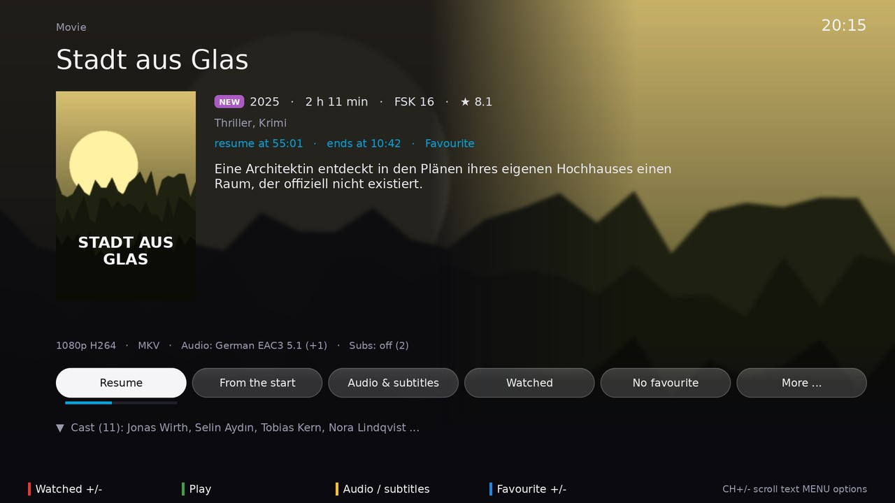
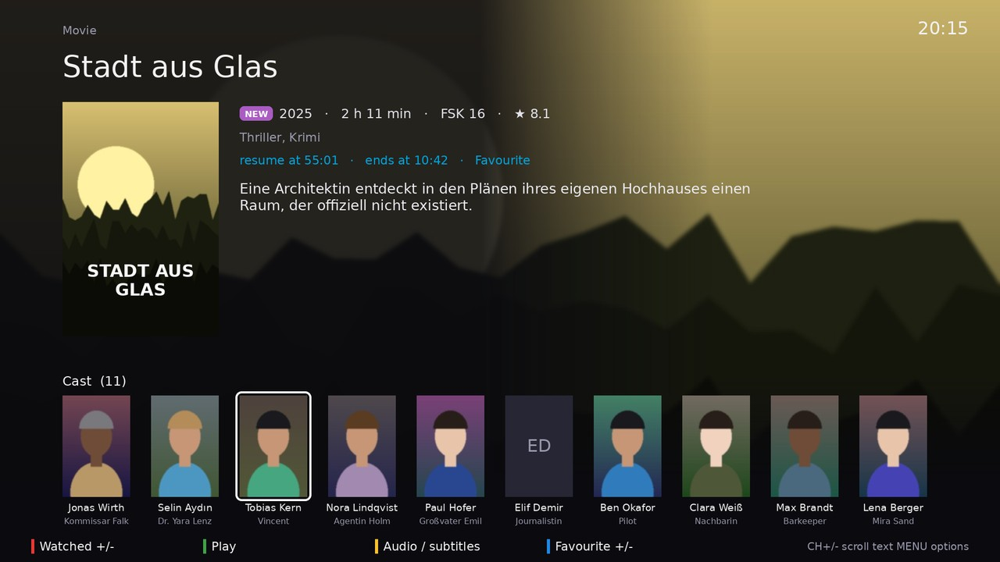
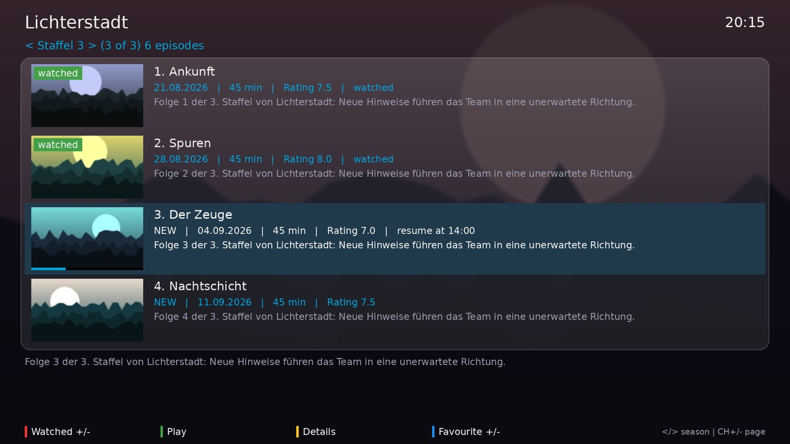
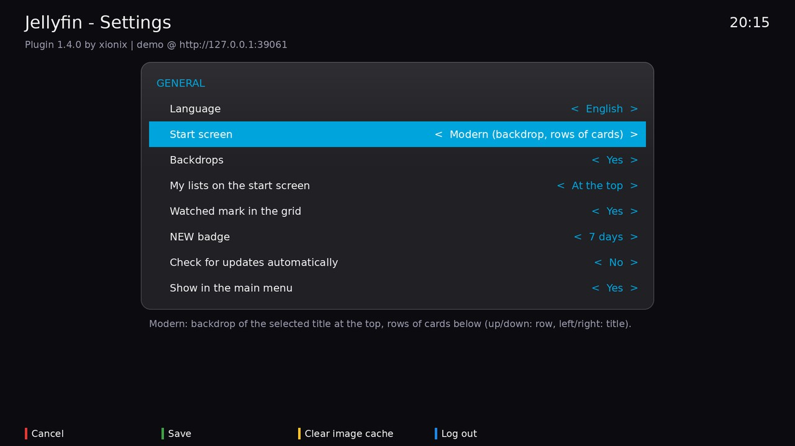

<p align="center">
  
</p>

<p align="center">
  <a href="README.md">🇩🇪 Deutsch</a> &nbsp;·&nbsp; <b>🇬🇧 English</b> &nbsp;·&nbsp; <a href="README.nl.md">🇳🇱 Nederlands</a>
</p>

<p align="center">
  <a href="https://github.com/sponsors/xionix3"></a><br>
  <sub>☕ The plugin is and stays free – no ads, no subscription. If you like it, I'd be happy about a coffee. Entirely voluntary, thank you! ❤</sub>
</p>

<p align="center">
  <a href="https://github.com/xionix3/jellyfine_enigma2_openpli/actions/workflows/ci.yml"></a>
  <a href="https://github.com/xionix3/jellyfine_enigma2_openpli/releases/latest"></a>
  <a href="https://github.com/xionix3/jellyfine_enigma2_openpli/releases"></a>
  
  
  <a href="LICENSE"></a>
</p>

**Jellyfin for Enigma2** is an unofficial [Jellyfin](https://jellyfin.org) client for set-top boxes running **OpenPLi 9**. Watch movies, shows and music from your own Jellyfin server on your TV – with a large hero backdrop, cast photos, resume, your own lists like "new movies", automatic next episode and auto-update. Designed on the **Octagon SF8008**, runs on every OpenPLi 9 box (pure Python, `Architecture: all`).

<p align="center"><b>Made by <a href="https://github.com/xionix3">xionix</a></b></p>

> 🌍 The user interface speaks **English, German and Dutch** – it follows the menu language of the box (other languages → English) and can be switched under *Settings → Language*.

---

## 📸 Screenshots

| | |
|:---:|:---:|
|  |  |
| **Start screen** – backdrop of the focused title, rows of cards below | **Details** – the picture stays visible, full description |
|  |  |
| **Movies/shows** like the start screen – ▲▼ jumps through the categories | **Genres and folders** as rows of their own |
|  |  |
| **Search** – real matches only, one row per category | **Cast** with photos – appears with ▼ |
|  |  |
| **New episodes of my shows** – one card per show | **Sidebar** – search, start, movies, shows, lists, settings |
|  |  |
| **Seasons & episodes** | **Show all** (red) – grid with sorting and filters |

<details>
<summary>More: my lists, list editor, settings, classic start screen, login</summary>

| | |
|:---:|:---:|
|  |  |
| **My lists** – your own filter rules | **List editor** |
|  |  |
| **Settings** | **Classic start screen** (menu on the left) |
|  | |
| **Login** | |

</details>

<sub>The screenshots show the real plugin screens with demo content (made-up titles, generated artwork). CI regenerates them on every run.</sub>

---

## ✨ Features

- **Login** with username/password or **Quick Connect** (no typing), automatic **server discovery** on the LAN
- **Modern start screen**: large backdrop and info of the focused title, rows of cards below (continue watching, next up, recently added, libraries, favourites, own lists) and a sidebar – the classic layout (menu left, posters right) is still available
- **Movies, shows and every library** look like the start screen: rows for continue watching, recently added, new releases, favourites, every genre or folder – ▲▼ jumps through them, no sub menus
- **Smooth**: pictures are decoded outside the GUI (ePicLoad), loaded at the exact screen size and kept in memory – nothing rebuilds while you scroll
- **Glass look**: rounded, translucent panels, frames and buttons (PNG based, so Enigma2 really blends them)
- **My lists**: your own filter rules, e.g. *new movies of the last 30 days* or *new episodes of the shows I watch*
- **Poster grid** with sorting, filters (unplayed, played, favourites, in progress, genre, **category**), NEW badge, progress bars and backdrop
- **Details**: poster on the left, clear info lines (facts with ★ rating, progress), the backdrop stays visible, the full description is readable; action buttons, audio/subtitle selection, versions, similar titles; the **cast with photos** appears with ▼ (OK lists the person's titles)
- **Search**: only titles that really contain the term – every category is searched on its own and shown as a row (movies, shows, episodes, collections, music, people)
- **Seasons & episodes**, **music albums**
- **English, German, Dutch**: follows the menu language of the box or is set by hand (*Settings → Language*)
- **Auto-update**: checks the GitHub releases on start (at most twice a day), installs the new version on request (checksum verified) and restarts Enigma2
- **Playback** through the Enigma2 movie player (GStreamer or ServiceApp):
  direct play in original quality (4K/HEVC on UHD boxes) or transcoded by the server (HLS), e.g. for DTS audio or picture-based subtitles
- **Skip intro**: while an intro, recap or preview runs, “Skip intro” appears – OK jumps to its end (or automatically). Needs Jellyfin 10.10+ with media segments, e.g. from the *Intro Skipper* plugin; older servers with Intro Skipper work too
- **Next episode**: during the credits the next episode counts down from 10 – OK plays it at once, EXIT stays with the credits
- Progress and watched state are reported to the server
- **Fast**: pictures on screen are loaded before anything else and appear together instead of one by one; HD and Full-HD skins, connection reuse, prefetching, optional image cache on HDD/USB

## 📦 Installation

**Quick** – via telnet/SSH on the box:

```sh
wget -O /tmp/jellyfin.ipk https://github.com/xionix3/jellyfine_enigma2_openpli/releases/latest/download/enigma2-plugin-extensions-jellyfine-enigma2-openpli_all.ipk \
  && opkg install /tmp/jellyfin.ipk && init 4 && sleep 2 && init 3
```

**Manual:** download the `.ipk` from the [latest release](https://github.com/xionix3/jellyfine_enigma2_openpli/releases/latest), copy it to `/tmp` on the box (FTP) and install:

```sh
opkg install /tmp/enigma2-plugin-extensions-jellyfine-enigma2-openpli_*_all.ipk
init 4 && sleep 2 && init 3      # restart the GUI
```

**Update:** automatic – the plugin tells you when a new version is out (can be turned off under *Settings → check for updates automatically*, manual check via *MENU → check for updates*). Installing as above works too; settings and lists are kept. Up to version 1.3.1 the package was called `enigma2-plugin-extensions-jellyfine2` – the update replaces it automatically, old install commands keep working.
**Remove:** `opkg remove enigma2-plugin-extensions-jellyfine-enigma2-openpli`

## 🚀 Getting started

1. Open *Main menu → Jellyfin*.
2. Enter the **server**, e.g. `http://192.168.1.10:8096` – or press **blue** to discover it on your network.
3. Enter **user** and **password** and log in with **green** – or press **yellow** for Quick Connect and confirm the code in the Jellyfin app under *User → Quick Connect*.

The login is remembered. Log out with **red** on the start screen.

## 🎮 Remote control

| Screen | Keys |
|---|---|
| **Start screen** | ▲▼ row · ◀▶ title · ◀ on the first card: sidebar · OK details/open · PLAY play · CH± jump 5 titles · 🔴 all titles of the row · 🟢 search · 🟡 refresh · 🔵 my lists · MENU layout, updates, log out … · EXIT back to the start, then quit |
| **Classic start screen** | ▲▼ section · OK open · 🟢 search · 🟡 refresh · 🔵 my lists · 🔴 log out · MENU more |
| **Poster grid** | arrows · CH+/- page · OK open · PLAY play · 🔴 sort · 🟢 filter/genre/category · 🟡 watched ± · 🔵 favourite ± · INFO details |
| **Movies / shows / library** | like the start screen: ▲▼ category, genre or folder · ◀▶ title · 🔴 all titles of the row as a grid |
| **Search results** | ▲▼ category (movies, shows, episodes, collections, music, people) · ◀▶ match · 🔴 all matches of the category |
| **Details** | ◀▶ button · ▼ show the cast, ▲ back · OK run / titles of the person · CH± scroll text · 🟢 play · 🟡 audio/subtitles · 🔴 watched ± · 🔵 favourite ± · MENU all actions |
| **Episodes** | ▲▼ episode · ◀▶ season · OK play · 🟡 details · MENU mark whole season watched |
| **My lists** | OK show list · 🟢 new · 🟡 edit · 🔴 delete · 🔵 move up · MENU start screen on/off, duplicate |
| **Player** | ◀ −10 s · ▶ +30 s · ▲▼ info bar · ⏮ ⏭ previous/next episode · INFO info · STOP/EXIT quit · AUDIO/SUBTITLE as usual |

## 🗂️ My lists

Own lists appear as sections at the top of the start screen. Per list you can set:

| Setting | Options |
|---|---|
| Content | movies · shows with new episodes · episodes · movies & shows |
| Library | all or a specific one |
| What is "new"? | *new on the server* (date added) or *newly released* (premiere) |
| Time window | 3 days to 2 years, or unlimited |
| Filters | unplayed only · only shows I watch · minimum rating · genre |
| Display | group per show · sort order · max. items · on the start screen yes/no |

**New movies** and **New episodes of my shows** are preset. **Shows with new episodes** and **Newly released** can be enabled in *My lists*.

## ⚙️ Settings

| Setting | Meaning |
|---|---|
| Language | automatic (menu language of the box) · Deutsch · English · Nederlands |
| Playback mode | automatic (server decides) · always direct · always transcode |
| Max. bitrate / resolution | for remote access or HD boxes; *automatic* detects UHD boxes |
| HEVC / DTS / TrueHD / VC-1 / VP9 | what the box may play directly (DTS/TrueHD default → AC3) |
| Player | GStreamer (4097) or – if installed – ServiceApp exteplayer3/gstplayer |
| Autoplay next episode, resume | behaviour for shows and saved positions |
| Skip intro/recap | show button (OK) · automatic · off |
| Start screen | modern (backdrop + rows of cards) or classic (menu left, posters right) |
| NEW badge, backdrops | look |
| Own lists on the start screen | top · after "continue watching" · bottom |
| Image cache | RAM (fast) or HDD/USB (survives a reboot) |
| Verify SSL certificate | turn off for servers with a self-signed certificate |
| Check for updates automatically | looks for new releases on GitHub on start and offers to install them |

## ❓ FAQ

<details>
<summary><b>No sound on some movies</b></summary>

The audio track is probably DTS or TrueHD. Make sure *play DTS/TrueHD directly* is set to **no** – the server then converts the audio to AC3.
</details>

<details>
<summary><b>"The server cannot prepare this item for the box"</b></summary>

Transcoding is disabled for your Jellyfin user. Enable "Allow video playback that requires transcoding" in the Jellyfin dashboard under *Users → Playback*.
</details>

<details>
<summary><b>Stuttering over the internet</b></summary>

Set *max. streaming bitrate* to e.g. 8 or 10 Mbit/s – the server then scales large files down.
</details>

<details>
<summary><b>SSL error with https</b></summary>

For self-signed certificates set *verify SSL certificate* to **no**.
</details>

<details>
<summary><b>Search does not find a title</b></summary>

Search matches titles. Every category is queried on its own, plus titles starting with the term; only what really contains the term is shown. If a title is still missing, check in the Jellyfin web UI that it is listed under exactly that name.
</details>

<details>
<summary><b>Reporting bugs</b></summary>

Please open an [issue](https://github.com/xionix3/jellyfine_enigma2_openpli/issues/new/choose) and attach the lines containing `[Jellyfin]` from the Enigma2 debug log (*Menu → Setup → System → Logs*), plus your box, image version and Jellyfin version. Remove anything after `api_key=`, `ApiKey=` or `Token=` first – Enigma2 itself logs the stream address. Please report **security issues** privately as described in [SECURITY.md](SECURITY.md).
</details>

## 🧩 Compatibility

- **Images:** OpenPLi 9.0 – 9.2 (Python 3). Other Python 3 images based on OpenPLi usually work as well.
- **Boxes:** every OpenPLi 9 receiver; 4K/HEVC direct play on UHD boxes such as SF8008, HD51, Vu+ 4K, Dreambox DM900/DM920 …
- **Jellyfin:** 10.8 to 10.11 (the API routes changed in 10.9 are detected automatically)
- **Skins:** HD (1280×720) and Full HD (1920×1080), own layout independent of the box skin
- Not included: Live TV/DVR, photos, books

<a id="development"></a>

## 🛠️ Development

Everything runs off-box: a fake Jellyfin server (`tests/mockjf.py`) and stubs of the Enigma2 Python API (`tests/e2stubs/`) run the real screens headless. The stubs validate skins against the screen components (a missing component is a `SkinError` on a real box), check every key action against the real OpenPLi `keymap.xml`, and catch attributes that would shadow the `Screen` dict API.

```sh
pip install -r requirements-dev.txt
make lint test ipk      # the .ipk ends up in dist/
make screenshots        # regenerates docs/screenshots/ (de, en/, nl/)
```

CI (GitHub Actions) runs lint and a Python 3.6 syntax check, the test matrix (Python 3.9–3.13 × OpenPLi 9.0/9.2 keymaps × Jellyfin 10.8/10.10/10.11 × HD/FHD), builds the `.ipk` and renders the screenshots.

**Releasing is automatic:** bump `CLIENT_VERSION` in `src/JellyfinOpenPLi/jfapi.py`, add a `CHANGELOG.md` entry and push to `main`. When the tests pass, CI creates the tag `vX.Y.Z` and the release with the `.ipk` (plus a stable-named copy for the one-line install and the auto-update), `SHA256SUMS` and the changelog section. Publishing a release or pushing a tag `vX.Y.Z` by hand works as well.

```
src/JellyfinOpenPLi/      plugin (installed to /usr/lib/enigma2/python/Plugins/Extensions/JellyfinOpenPLi)
  jfapi.py           Jellyfin REST client (pure python, keep-alive)
  jfrules.py         "my lists" rule engine (pure python)
  jfhome / jfgrid / jfdetail / jfepisodes / jfplayer / jflogin / jfsettings / jfrulesui   screens
  jfskin.py          embedded skins, designed for 1920x1080 and scaled at runtime
  jfrows.py          row screens (start screen, libraries, search): hero + one row of cards, sidebar
  jfupdate.py        update check against the GitHub releases, download + opkg install
  jfi18n.py, locale/ translations (German source texts, en.po, nl.po)
  images/            glass panels, gradients, frames, pills, icons; pixel exact for 1080p, images/hd/ for 720p
                     (generated by scripts/make_assets.py)
tests/               fake server, demo data, Enigma2 stubs, end-to-end tests, screenshot renderer
scripts/             ipk builder, syntax check, asset, icon and banner generators
```

**Translations:** the German texts in the code are the msgids, the translations live in `src/JellyfinOpenPLi/locale/en.po` and `nl.po` (editable with Poedit). After changing texts run `make i18n` – new texts appear with an empty `msgstr`; `scripts/i18n.py check` (also in CI) makes sure every text is translated. A new language is one more `.po` file plus an entry in `LANGUAGES` in `jfi18n.py`.

Contributions are welcome – issues and pull requests in English or German, improved translations too.

## 📄 License

[GPL-2.0-or-later](LICENSE) · © 2026 [xionix](https://github.com/xionix3). This project is not affiliated with the Jellyfin project or OpenPLi. Please use it with your own Jellyfin server and media you have the rights to.
