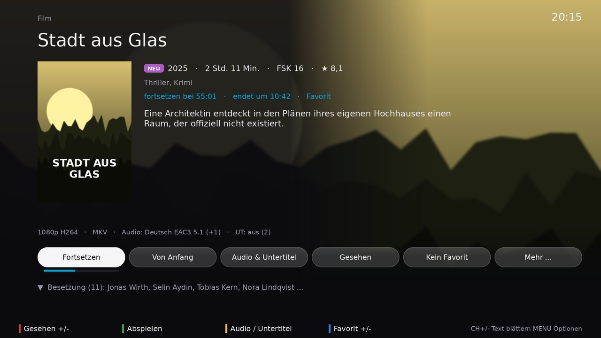
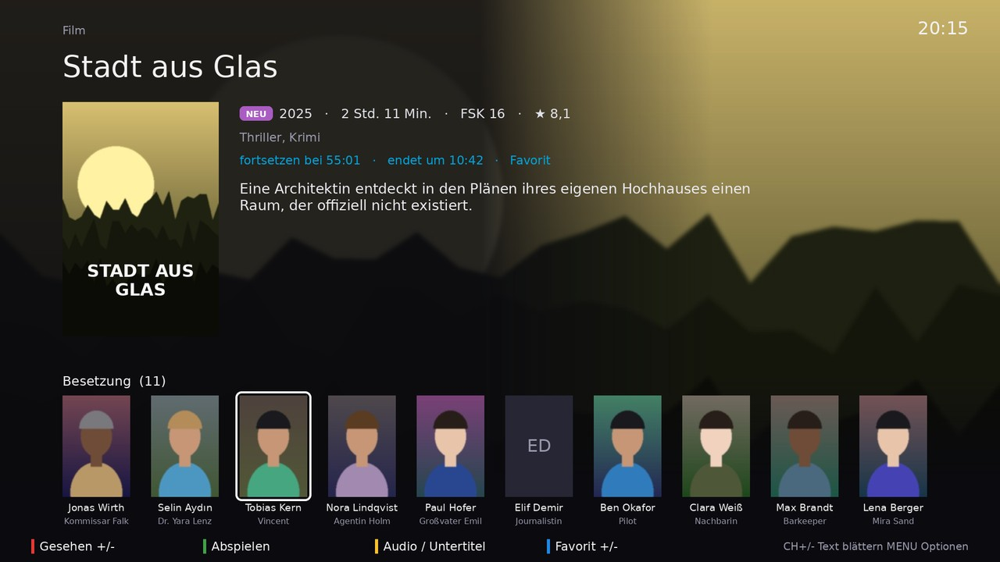
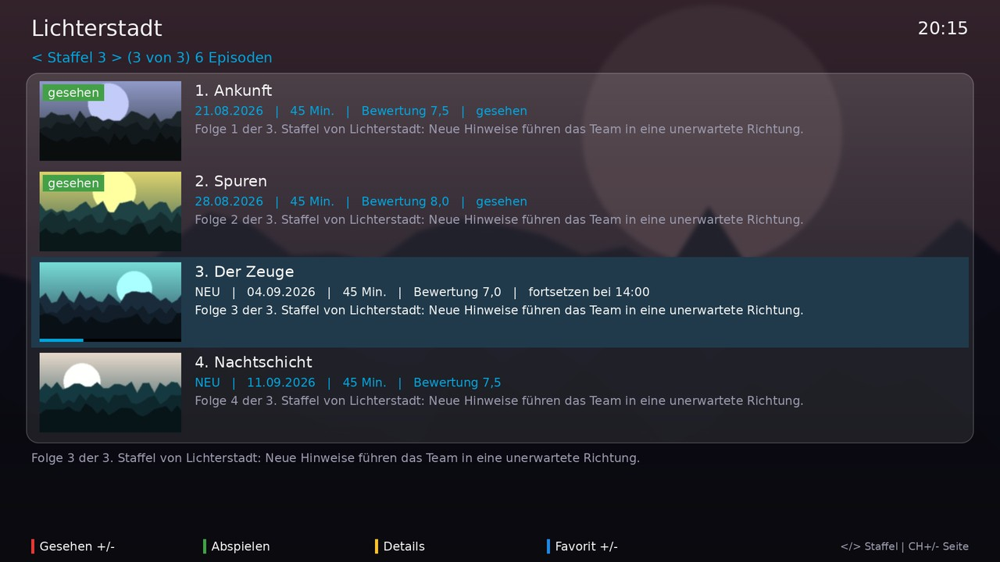
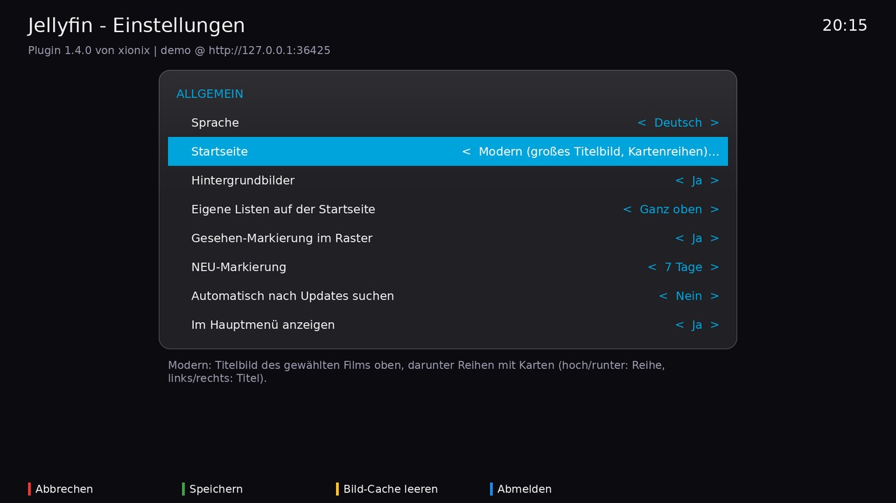

<p align="center">
  
</p>

<p align="center">
  <b>🇩🇪 Deutsch</b> &nbsp;·&nbsp; <a href="README.en.md">🇬🇧 English</a> &nbsp;·&nbsp; <a href="README.nl.md">🇳🇱 Nederlands</a>
</p>

<p align="center">
  <a href="https://github.com/sponsors/xionix3"></a><br>
  <sub>☕ Das Plugin ist und bleibt kostenlos – ohne Werbung, ohne Abo. Wenn es dir gefällt, freue ich mich über einen Kaffee. Völlig freiwillig, danke! ❤</sub>
</p>

<p align="center">
  <a href="https://github.com/xionix3/jellyfine_enigma2_openpli/actions/workflows/ci.yml"></a>
  <a href="https://github.com/xionix3/jellyfine_enigma2_openpli/releases/latest"></a>
  <a href="https://github.com/xionix3/jellyfine_enigma2_openpli/releases"></a>
  
  
  <a href="LICENSE"></a>
</p>

**Jellyfin für Enigma2** ist ein inoffizieller [Jellyfin](https://jellyfin.org)-Client für Receiver mit **OpenPLi 9**. Du siehst Filme, Serien und Musik von deinem eigenen Jellyfin-Server direkt am Fernseher – mit großem Titelbild, Schauspielerfotos, Fortsetzen-Funktion, eigenen Listen wie „Neue Filme“, automatischer nächster Episode und Auto-Update. Entwickelt und gestaltet auf der **Octagon SF8008**, läuft aber auf jeder OpenPLi-9-Box (reines Python, `Architecture: all`).

<p align="center"><b>Entwickelt von <a href="https://github.com/xionix3">xionix</a></b></p>

---

## 📸 Screenshots

| | |
|:---:|:---:|
|  |  |
| **Startseite** – Titelbild des gewählten Titels, darunter Kartenreihen | **Details** – Bild bleibt sichtbar, Beschreibung ganz lesbar |
|  |  |
| **Filme/Serien** wie die Startseite – ▲▼ springt durch die Kategorien | **Genres und Ordner** als eigene Reihen |
|  |  |
| **Suche** – nur echte Treffer, eine Reihe pro Kategorie | **Besetzung** mit Fotos – erst nach ▼ |
|  |  |
| **Neue Episoden meiner Serien** – eine Karte pro Serie | **Seitenleiste** – Suche, Start, Filme, Serien, Listen, Einstellungen |
|  |  |
| **Staffeln & Episoden** | **Alle anzeigen** (Rot) – Raster mit Sortierung und Filtern |

<details>
<summary>Weitere: Meine Listen, Listen-Editor, Einstellungen, klassische Startseite, Anmeldung</summary>

| | |
|:---:|:---:|
|  |  |
| **Meine Listen** – eigene Filterregeln | **Listen-Editor** |
|  |  |
| **Einstellungen** | **Klassische Startseite** (Menü links) |
|  | |
| **Anmeldung** | |

</details>

<sub>Die Screenshots zeigen die echten Plugin-Bildschirme mit Demo-Inhalten (erfundene Titel, generierte Bilder). Sie werden bei jedem CI-Lauf neu erzeugt.</sub>

---

## ✨ Funktionen

- **Anmeldung** mit Benutzer/Passwort oder **Quick Connect** (ohne Tippen), automatische **Serversuche** im Heimnetz
- **Moderne Startseite**: großes Hintergrundbild und Infos zum gewählten Titel, darunter Reihen mit Karten (Weiterschauen, Als Nächstes, Neu hinzugefügt, Bibliotheken, Favoriten, eigene Listen) und eine Seitenleiste – die klassische Ansicht (Menü links, Poster rechts) gibt es weiterhin
- **Filme, Serien und jede Bibliothek** sehen aus wie die Startseite: Reihen für Weiterschauen, Neu hinzugefügt, Neu erschienen, Favoriten, jedes Genre bzw. jeden Ordner – mit ▲▼ springst du durch, keine Unterauswahl
- **Flüssig**: Bilder werden außerhalb der Oberfläche dekodiert (ePicLoad), in exakter Bildschirmgröße geladen und im Speicher gehalten – beim Blättern baut sich nichts neu auf
- **Glas-Optik**: abgerundete, halbtransparente Flächen, Rahmen und Buttons (als PNG, damit Enigma2 sie wirklich überblendet)
- **Meine Listen**: eigene Filterregeln, z. B. *Neue Filme der letzten 30 Tage* oder *Neue Episoden meiner Serien*
- **Poster-Raster** mit Sortierung, Filtern (ungesehen, gesehen, Favoriten, begonnen, Genre, **Kategorie**), NEU-Schild, Fortschrittsbalken und Hintergrundbild
- **Details**: Poster links, klare Infozeilen (Fakten mit ★-Bewertung, Fortschritt), das Hintergrundbild bleibt sichtbar, die Beschreibung ist ganz lesbar; Aktions-Buttons, Audiospur- und Untertitelauswahl, Versionen, ähnliche Titel; die **Besetzung mit Fotos** erscheint mit ▼ (OK zeigt die Filme der Person)
- **Suche**: nur Titel, die den Suchbegriff wirklich enthalten – jede Kategorie wird einzeln gesucht und als eigene Reihe gezeigt (Filme, Serien, Episoden, Sammlungen, Musik, Personen)
- **Staffeln & Episoden**, **Musikalben**
- **Deutsch, Englisch, Niederländisch**: richtet sich nach der Menüsprache der Box oder wird von Hand gewählt (*Einstellungen → Sprache*)
- **Auto-Update**: prüft beim Start (höchstens zweimal täglich) die GitHub-Releases, installiert auf Wunsch die neue Version (mit Prüfsumme) und startet Enigma2 neu
- **Wiedergabe** über den Enigma2-Movieplayer (GStreamer oder ServiceApp):
  direkt in Originalqualität (auf UHD-Boxen auch 4K/HEVC) oder vom Server umgewandelt (HLS), z. B. bei DTS-Ton oder Bild-Untertiteln
- **Intro überspringen**: läuft ein Intro, Rückblick oder eine Vorschau, erscheint „Intro überspringen“ – OK springt ans Ende (oder automatisch). Braucht Jellyfin 10.10+ mit Medien-Segmenten, z. B. vom Plugin *Intro Skipper*; ältere Server mit Intro Skipper gehen auch
- **Nächste Folge**: im Abspann zählt die nächste Episode von 10 herunter – OK spielt sofort, EXIT bleibt beim Abspann
- Fortschritt und Gesehen-Status werden an den Server gemeldet
- **Schnell**: sichtbare Bilder werden vor allem anderen geladen und erscheinen gemeinsam statt Stück für Stück; HD- und Full-HD-Skins, wiederverwendete Verbindungen, Vorladen, Bild-Cache optional auf HDD/USB

## 📦 Installation

**Schnell** – per Telnet/SSH auf der Box:

```sh
wget -O /tmp/jellyfin.ipk https://github.com/xionix3/jellyfine_enigma2_openpli/releases/latest/download/enigma2-plugin-extensions-jellyfine-enigma2-openpli_all.ipk \
  && opkg install /tmp/jellyfin.ipk && init 4 && sleep 2 && init 3
```

**Manuell:** Die `.ipk` aus dem [neuesten Release](https://github.com/xionix3/jellyfine_enigma2_openpli/releases/latest) herunterladen, per FTP nach `/tmp` auf die Box kopieren und installieren:

```sh
opkg install /tmp/enigma2-plugin-extensions-jellyfine-enigma2-openpli_*_all.ipk
init 4 && sleep 2 && init 3      # GUI neu starten
```

**Update:** passiert automatisch – das Plugin meldet sich, sobald es eine neue Version gibt (abschaltbar unter *Einstellungen → Automatisch nach Updates suchen*, manuell über *MENU → Nach Updates suchen*). Alternativ wie oben installieren; Einstellungen und Listen bleiben erhalten. Bis Version 1.3.1 hieß das Paket `enigma2-plugin-extensions-jellyfine2` – das Update ersetzt es automatisch, alte Installationsbefehle funktionieren weiter.
**Entfernen:** `opkg remove enigma2-plugin-extensions-jellyfine-enigma2-openpli`

## 🚀 Erste Schritte

1. *Hauptmenü → Jellyfin* öffnen.
2. **Server** eintragen, z. B. `http://192.168.1.10:8096` – oder mit **Blau** den Server im Netzwerk suchen.
3. **Benutzer** und **Passwort** eingeben und mit **Grün** anmelden – oder **Gelb** für Quick Connect: Den angezeigten Code in der Jellyfin-App unter *Benutzer → Quick Connect* bestätigen.

Die Anmeldung bleibt gespeichert. Abmelden mit **Rot** auf der Startseite.

## 🎮 Bedienung

| Bildschirm | Tasten |
|---|---|
| **Startseite** | ▲▼ Reihe · ◀▶ Titel · ◀ am Anfang: Seitenleiste · OK Details/öffnen · PLAY abspielen · CH± 5 Titel weiter · 🔴 alle Titel der Reihe · 🟢 Suche · 🟡 aktualisieren · 🔵 Meine Listen · MENU Ansicht, Updates, Abmelden … · EXIT zurück zum Anfang, dann beenden |
| **Klassische Startseite** | ▲▼ Bereich · OK öffnen · 🟢 Suche · 🟡 aktualisieren · 🔵 Meine Listen · 🔴 abmelden · MENU mehr |
| **Poster-Raster** | Pfeiltasten · CH+/- Seite · OK öffnen · PLAY abspielen · 🔴 Sortierung · 🟢 Filter/Genre/Kategorie · 🟡 gesehen ± · 🔵 Favorit ± · INFO Details |
| **Filme / Serien / Bibliothek** | wie die Startseite: ▲▼ Kategorie, Genre oder Ordner · ◀▶ Titel · 🔴 alle Titel der Reihe als Raster |
| **Suchergebnisse** | ▲▼ Kategorie (Filme, Serien, Episoden, Sammlungen, Musik, Personen) · ◀▶ Treffer · 🔴 alle Treffer der Kategorie |
| **Details** | ◀▶ Button wählen · ▼ Besetzung einblenden, ▲ zurück · OK ausführen / Filme der Person · CH± Text blättern · 🟢 abspielen · 🟡 Audio/Untertitel · 🔴 gesehen ± · 🔵 Favorit ± · MENU alle Aktionen |
| **Episoden** | ▲▼ Episode · ◀▶ Staffel · OK abspielen · 🟡 Details · MENU ganze Staffel als gesehen markieren |
| **Meine Listen** | OK Liste anzeigen · 🟢 neu · 🟡 bearbeiten · 🔴 löschen · 🔵 nach oben · MENU Startseite an/aus, duplizieren |
| **Player** | ◀ −10 s · ▶ +30 s · ▲▼ Infoleiste · ⏮ ⏭ vorige/nächste Episode · INFO Infos · STOP/EXIT beenden · AUDIO/SUBTITLE wie gewohnt |

## 🗂️ Meine Listen

Eigene Listen erscheinen als Bereiche ganz oben auf der Startseite. Pro Liste einstellbar:

| Einstellung | Möglichkeiten |
|---|---|
| Inhalt | Filme · Serien mit neuen Folgen · Episoden · Filme & Serien |
| Bibliothek | alle oder eine bestimmte |
| Was ist „neu“? | *neu auf dem Server* (Hinzufügedatum) oder *neu erschienen* (Premiere) |
| Zeitraum | 3 Tage bis 2 Jahre oder unbegrenzt |
| Filter | nur ungesehene · nur Serien, die ich schaue · Mindestbewertung · Genre |
| Darstellung | pro Serie zusammenfassen · Sortierung · max. Einträge · auf der Startseite ja/nein |

Vorbelegt sind **Neue Filme** und **Neue Episoden meiner Serien**. **Serien mit neuen Folgen** und **Neu erschienen** lassen sich in *Meine Listen* einblenden.

## ⚙️ Einstellungen

| Einstellung | Bedeutung |
|---|---|
| Sprache | Automatisch (Menüsprache der Box) · Deutsch · English · Nederlands |
| Wiedergabe-Modus | Automatisch (Server entscheidet) · immer direkt · immer umwandeln |
| Max. Bitrate / Auflösung | für Fernzugriff oder HD-Boxen; *Automatisch* erkennt UHD-Boxen |
| HEVC / DTS / TrueHD / VC-1 / VP9 | was die Box direkt abspielen darf (DTS/TrueHD standardmäßig → AC3) |
| Player | GStreamer (4097) oder – falls installiert – ServiceApp exteplayer3/gstplayer |
| Nächste Episode automatisch, Fortsetzen | Verhalten bei Serien und gespeicherter Position |
| Intro/Rückblick überspringen | Knopf anzeigen (OK) · automatisch · aus |
| Startseite | Modern (Titelbild + Kartenreihen) oder Klassisch (Menü links, Poster rechts) |
| NEU-Markierung, Hintergrundbilder | Aussehen |
| Eigene Listen auf der Startseite | ganz oben · nach „Weiterschauen“ · unten |
| Bild-Cache | RAM (schnell) oder HDD/USB (bleibt nach Neustart erhalten) |
| SSL-Zertifikat prüfen | für Server mit selbstsigniertem Zertifikat abschalten |
| Automatisch nach Updates suchen | prüft beim Start die Releases auf GitHub und bietet neue Versionen an |

## ❓ Häufige Fragen

<details>
<summary><b>Kein Ton bei manchen Filmen</b></summary>

Die Tonspur ist vermutlich DTS oder TrueHD. Stelle in den Einstellungen sicher, dass *DTS/TrueHD direkt abspielen* auf **Nein** steht – dann wandelt der Server den Ton in AC3 um.
</details>

<details>
<summary><b>„Der Server kann dieses Element nicht für die Box aufbereiten“</b></summary>

Für deinen Jellyfin-Benutzer ist das Umwandeln (Transkodierung) deaktiviert. Aktiviere im Jellyfin-Dashboard unter *Benutzer → Wiedergabe* „Transkodierung erlauben“.
</details>

<details>
<summary><b>Ruckeln über das Internet</b></summary>

*Max. Streaming-Bitrate* z. B. auf 8 oder 10 Mbit/s stellen – der Server rechnet große Dateien dann herunter.
</details>

<details>
<summary><b>SSL-Fehler bei https</b></summary>

Bei selbstsignierten Zertifikaten *SSL-Zertifikat prüfen* auf **Nein** stellen.
</details>

<details>
<summary><b>Die Suche findet einen Titel nicht</b></summary>

Gesucht wird im Titel. Jede Kategorie wird einzeln abgefragt, zusätzlich nach Titeln, die mit dem Begriff beginnen; angezeigt wird nur, was den Begriff wirklich enthält. Steht ein Titel trotzdem nicht in der Liste, prüfe in der Jellyfin-Weboberfläche, ob er dort unter genau diesem Namen geführt wird.
</details>

<details>
<summary><b>Fehler melden</b></summary>

Bitte ein [Issue](https://github.com/xionix3/jellyfine_enigma2_openpli/issues/new/choose) anlegen und die Zeilen mit `[Jellyfin]` aus dem Enigma2-Debug-Log anhängen (*Menü → Einstellungen → System → Logs*), dazu Box, Image-Version und Jellyfin-Version. Vorher alles nach `api_key=`, `ApiKey=` oder `Token=` unkenntlich machen – Enigma2 selbst schreibt die Stream-Adresse ins Log. **Sicherheitslücken** bitte nicht öffentlich, sondern wie in [SECURITY.md](SECURITY.md) beschrieben melden.
</details>

## 🧩 Kompatibilität

- **Images:** OpenPLi 9.0 – 9.2 (Python 3). Andere Python-3-Images mit OpenPLi-Basis funktionieren meist ebenfalls.
- **Boxen:** alle OpenPLi-9-Receiver; 4K/HEVC direkt auf UHD-Boxen wie SF8008, HD51, Vu+ 4K, Dreambox DM900/DM920 …
- **Jellyfin:** 10.8 bis 10.11 (die in 10.9 geänderten API-Routen werden automatisch erkannt)
- **Skins:** HD (1280×720) und Full HD (1920×1080), eigenständiges Layout unabhängig vom Box-Skin
- Nicht enthalten: Live-TV/DVR, Fotos, Bücher

## 🛠️ Entwicklung

Alles läuft ohne Box: ein nachgebauter Jellyfin-Server und Nachbildungen der Enigma2-Python-API führen die echten Bildschirme aus. Dabei werden Skins gegen die Bildschirm-Komponenten geprüft, alle Tasten gegen die echte OpenPLi-`keymap.xml` und typische Box-Abstürze erkannt.

```sh
pip install -r requirements-dev.txt
make lint test ipk      # .ipk liegt danach in dist/
make screenshots        # erzeugt docs/screenshots/ neu (de, en/, nl/)
```

Die CI (GitHub Actions) prüft Lint und Python-3.6-Syntax, testet in einer Matrix (Python 3.9–3.13 × OpenPLi 9.0/9.2 × Jellyfin 10.8/10.10/10.11 × HD/FHD), baut die `.ipk` und erzeugt die Screenshots. **Releases entstehen automatisch:** Wird `CLIENT_VERSION` in `src/JellyfinOpenPLi/jfapi.py` erhöht und nach `main` gepusht, legt die CI den Tag `vX.Y.Z` und das Release mit `.ipk`, `SHA256SUMS` und dem Abschnitt aus dem [CHANGELOG](CHANGELOG.md) an – darauf greift das Auto-Update zu. Details zum Aufbau stehen in der [englischen Version](README.en.md#development).

**Übersetzungen:** Die deutschen Texte im Code sind die Vorlage, Englisch und Niederländisch liegen in `src/JellyfinOpenPLi/locale/en.po` und `nl.po` (mit Poedit bearbeitbar). Nach Textänderungen `make i18n` ausführen; `scripts/i18n.py check` (auch in der CI) prüft, dass alles übersetzt ist.

Beiträge sind willkommen – Issues und Pull Requests gerne auf Deutsch oder Englisch, auch bessere Übersetzungen.

## 📄 Lizenz

[GPL-2.0-or-later](LICENSE) · © 2026 [xionix](https://github.com/xionix3). Dieses Projekt ist nicht mit dem Jellyfin-Projekt oder OpenPLi verbunden. Bitte nur mit deinem eigenen Jellyfin-Server und Medien nutzen, an denen du die Rechte hast.
