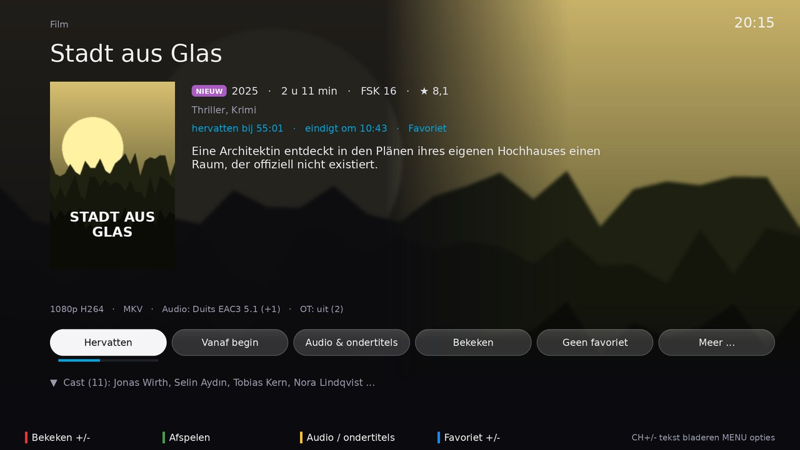
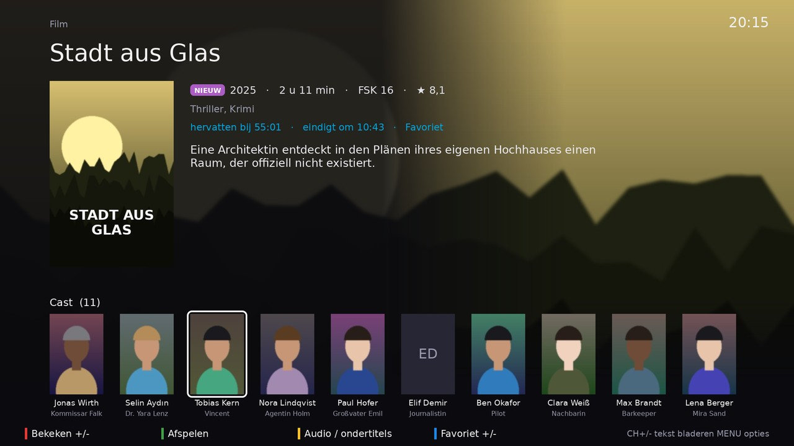
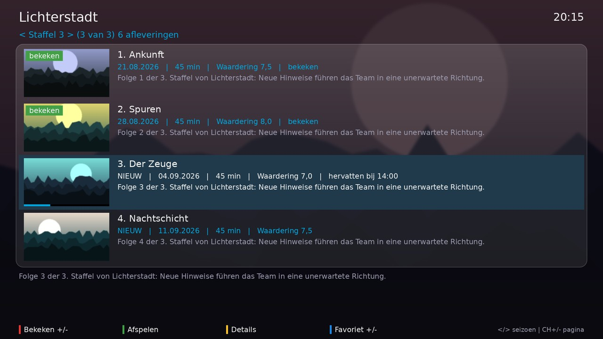
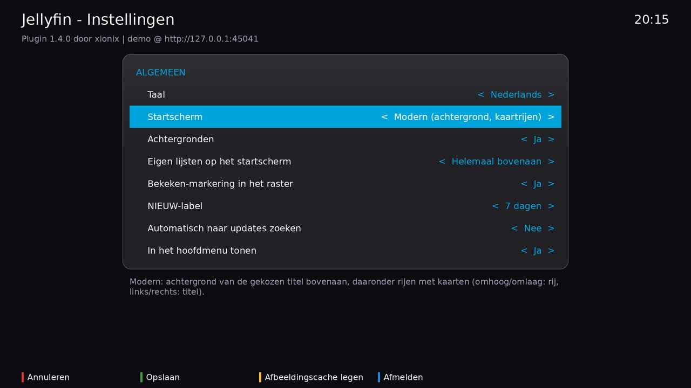

<p align="center">
  
</p>

<p align="center">
  <a href="README.md">🇩🇪 Deutsch</a> &nbsp;·&nbsp; <a href="README.en.md">🇬🇧 English</a> &nbsp;·&nbsp; <b>🇳🇱 Nederlands</b>
</p>

<p align="center">
  <a href="https://github.com/sponsors/xionix3"></a><br>
  <sub>☕ De plugin is en blijft gratis – zonder reclame, zonder abonnement. Vind je hem goed, dan ben ik blij met een kopje koffie. Helemaal vrijwillig, bedankt! ❤</sub>
</p>

<p align="center">
  <a href="https://github.com/xionix3/jellyfine_enigma2_openpli/actions/workflows/ci.yml"></a>
  <a href="https://github.com/xionix3/jellyfine_enigma2_openpli/releases/latest"></a>
  <a href="https://github.com/xionix3/jellyfine_enigma2_openpli/releases"></a>
  
  
  <a href="LICENSE"></a>
</p>

**Jellyfin voor Enigma2** is een onofficiële [Jellyfin](https://jellyfin.org)-client voor ontvangers met **OpenPLi 9**. Bekijk films, series en muziek van je eigen Jellyfin-server rechtstreeks op je tv – met een grote achtergrondafbeelding, foto's van de cast, verder kijken, eigen lijsten zoals "nieuwe films", automatisch de volgende aflevering en automatische updates. Ontworpen op de **Octagon SF8008**, werkt op elke OpenPLi 9-box (puur Python, `Architecture: all`).

<p align="center"><b>Gemaakt door <a href="https://github.com/xionix3">xionix</a></b></p>

> 🌍 De interface is beschikbaar in het **Nederlands, Engels en Duits** – hij volgt de menutaal van de box (andere talen → Engels) en is om te schakelen onder *Instellingen → Taal*.

---

## 📸 Screenshots

| | |
|:---:|:---:|
|  |  |
| **Startscherm** – achtergrond van de gekozen titel, daaronder rijen met kaarten | **Details** – het beeld blijft zichtbaar, volledige beschrijving |
|  |  |
| **Films/series** zoals het startscherm – ▲▼ springt door de categorieën | **Genres en mappen** als eigen rijen |
|  |  |
| **Zoeken** – alleen echte treffers, één rij per categorie | **Cast** met foto's – verschijnt met ▼ |
|  |  |
| **Nieuwe afleveringen van mijn series** – één kaart per serie | **Zijbalk** – zoeken, start, films, series, lijsten, instellingen |
|  |  |
| **Seizoenen & afleveringen** | **Alles tonen** (rood) – overzicht met sorteren en filters |

<details>
<summary>Meer: mijn lijsten, lijsteditor, instellingen, klassiek startscherm, inloggen</summary>

| | |
|:---:|:---:|
|  |  |
| **Mijn lijsten** – eigen filterregels | **Lijsteditor** |
|  |  |
| **Instellingen** | **Klassiek startscherm** (menu links) |
|  | |
| **Inloggen** | |

</details>

<sub>De screenshots tonen de echte schermen van de plugin met demo-inhoud (verzonnen titels, gegenereerde afbeeldingen). De CI maakt ze bij elke run opnieuw.</sub>

---

## ✨ Functies

- **Inloggen** met gebruikersnaam/wachtwoord of **Quick Connect** (zonder typen), automatisch **server zoeken** in het thuisnetwerk
- **Modern startscherm**: grote achtergrond en info van de gekozen titel, daaronder rijen met kaarten (verder kijken, volgende, onlangs toegevoegd, bibliotheken, favorieten, eigen lijsten) en een zijbalk – de klassieke weergave (menu links, posters rechts) blijft beschikbaar
- **Films, series en elke bibliotheek** zien eruit als het startscherm: rijen voor verder kijken, onlangs toegevoegd, nieuw verschenen, favorieten, elk genre of elke map – met ▲▼ spring je erdoor, geen submenu's
- **Vloeiend**: afbeeldingen worden buiten de interface gedecodeerd (ePicLoad), op exacte schermgrootte geladen en in het geheugen gehouden – bij het bladeren wordt niets opnieuw opgebouwd
- **Glas-look**: afgeronde, doorschijnende vlakken, kaders en knoppen (als PNG, zodat Enigma2 ze echt laat overvloeien)
- **Mijn lijsten**: eigen filterregels, bv. *nieuwe films van de laatste 30 dagen* of *nieuwe afleveringen van de series die ik kijk*
- **Posteroverzicht** met sorteren, filters (niet bekeken, bekeken, favorieten, begonnen, genre, **categorie**), NIEUW-label, voortgangsbalken en achtergrondafbeelding
- **Details**: poster links, duidelijke inforegels (feiten met ★-waardering, voortgang), de achtergrond blijft zichtbaar, de volledige beschrijving is leesbaar; actieknoppen, audio- en ondertitelkeuze, versies, vergelijkbare titels; de **cast met foto's** verschijnt met ▼ (OK toont de titels van de persoon)
- **Zoeken**: alleen titels die de zoekterm echt bevatten – elke categorie wordt apart gezocht en als eigen rij getoond (films, series, afleveringen, collecties, muziek, personen)
- **Seizoenen & afleveringen**, **muziekalbums**
- **Nederlands, Engels, Duits**: volgt de menutaal van de box of wordt handmatig gekozen (*Instellingen → Taal*)
- **Automatische updates**: controleert bij het starten (hoogstens twee keer per dag) de GitHub-releases, installeert op verzoek de nieuwe versie (met controlesom) en herstart Enigma2
- **Afspelen** via de Enigma2-moviespeler (GStreamer of ServiceApp):
  direct in originele kwaliteit (4K/HEVC op UHD-boxen) of omgezet door de server (HLS), bv. bij DTS-geluid of beeldondertitels
- **Intro overslaan**: tijdens een intro, terugblik of voorvertoning verschijnt „Intro overslaan“ – OK springt naar het einde (of automatisch). Vereist Jellyfin 10.10+ met mediasegmenten, bv. van de plugin *Intro Skipper*; oudere servers met Intro Skipper werken ook
- **Volgende aflevering**: tijdens de aftiteling telt de volgende aflevering af vanaf 10 – OK speelt meteen, EXIT blijft bij de aftiteling
- Voortgang en bekeken-status worden aan de server gemeld
- **Snel**: zichtbare afbeeldingen worden vóór al het andere geladen en verschijnen samen in plaats van één voor één; HD- en Full-HD-skins, hergebruik van verbindingen, vooraf laden, afbeeldingscache optioneel op HDD/USB

## 📦 Installatie

**Snel** – via telnet/SSH op de box:

```sh
wget -O /tmp/jellyfin.ipk https://github.com/xionix3/jellyfine_enigma2_openpli/releases/latest/download/enigma2-plugin-extensions-jellyfine-enigma2-openpli_all.ipk \
  && opkg install /tmp/jellyfin.ipk && init 4 && sleep 2 && init 3
```

**Handmatig:** download de `.ipk` uit de [nieuwste release](https://github.com/xionix3/jellyfine_enigma2_openpli/releases/latest), kopieer hem via FTP naar `/tmp` op de box en installeer:

```sh
opkg install /tmp/enigma2-plugin-extensions-jellyfine-enigma2-openpli_*_all.ipk
init 4 && sleep 2 && init 3      # GUI herstarten
```

**Bijwerken:** gaat automatisch – de plugin meldt zich zodra er een nieuwe versie is (uit te zetten onder *Instellingen → Automatisch naar updates zoeken*, handmatig via *MENU → Naar updates zoeken*). Installeren zoals hierboven kan ook; instellingen en lijsten blijven behouden. Tot versie 1.3.1 heette het pakket `enigma2-plugin-extensions-jellyfine2` – de update vervangt het automatisch, oude installatiecommando's blijven werken.
**Verwijderen:** `opkg remove enigma2-plugin-extensions-jellyfine-enigma2-openpli`

## 🚀 Aan de slag

1. Open *Hoofdmenu → Jellyfin*.
2. Vul de **server** in, bv. `http://192.168.1.10:8096` – of druk op **blauw** om hem in het netwerk te zoeken.
3. Vul **gebruiker** en **wachtwoord** in en log in met **groen** – of druk op **geel** voor Quick Connect en bevestig de code in de Jellyfin-app onder *Gebruiker → Quick Connect*.

De aanmelding wordt onthouden. Afmelden met **rood** op het startscherm.

## 🎮 Bediening

| Scherm | Toetsen |
|---|---|
| **Startscherm** | ▲▼ rij · ◀▶ titel · ◀ op de eerste kaart: zijbalk · OK details/openen · PLAY afspelen · CH± 5 titels verder · 🔴 alle titels van de rij · 🟢 zoeken · 🟡 vernieuwen · 🔵 mijn lijsten · MENU weergave, updates, afmelden … · EXIT terug naar het begin, dan afsluiten |
| **Klassiek startscherm** | ▲▼ onderdeel · OK openen · 🟢 zoeken · 🟡 vernieuwen · 🔵 mijn lijsten · 🔴 afmelden · MENU meer |
| **Posteroverzicht** | pijltjes · CH+/- pagina · OK openen · PLAY afspelen · 🔴 sorteren · 🟢 filter/genre/categorie · 🟡 bekeken ± · 🔵 favoriet ± · INFO details |
| **Films / series / bibliotheek** | zoals het startscherm: ▲▼ categorie, genre of map · ◀▶ titel · 🔴 alle titels van de rij als overzicht |
| **Zoekresultaten** | ▲▼ categorie (films, series, afleveringen, collecties, muziek, personen) · ◀▶ treffer · 🔴 alle treffers van de categorie |
| **Details** | ◀▶ knop · ▼ cast tonen, ▲ terug · OK uitvoeren / titels van de persoon · CH± tekst bladeren · 🟢 afspelen · 🟡 audio/ondertitels · 🔴 bekeken ± · 🔵 favoriet ± · MENU alle acties |
| **Afleveringen** | ▲▼ aflevering · ◀▶ seizoen · OK afspelen · 🟡 details · MENU heel seizoen als bekeken markeren |
| **Mijn lijsten** | OK lijst tonen · 🟢 nieuw · 🟡 bewerken · 🔴 verwijderen · 🔵 omhoog · MENU startscherm aan/uit, dupliceren |
| **Speler** | ◀ −10 s · ▶ +30 s · ▲▼ infobalk · ⏮ ⏭ vorige/volgende aflevering · INFO info · STOP/EXIT stoppen · AUDIO/SUBTITLE zoals gewoonlijk |

## 🗂️ Mijn lijsten

Eigen lijsten verschijnen als onderdelen bovenaan het startscherm. Per lijst in te stellen:

| Instelling | Mogelijkheden |
|---|---|
| Inhoud | films · series met nieuwe afleveringen · afleveringen · films & series |
| Bibliotheek | alle of een bepaalde |
| Wat is "nieuw"? | *nieuw op de server* (datum toegevoegd) of *nieuw verschenen* (première) |
| Periode | 3 dagen tot 2 jaar, of onbeperkt |
| Filters | alleen niet bekeken · alleen series die ik kijk · minimale beoordeling · genre |
| Weergave | per serie samenvoegen · sortering · max. aantal · op het startscherm ja/nee |

**Nieuwe films** en **Nieuwe afleveringen van mijn series** zijn vooraf ingesteld. **Series met nieuwe afleveringen** en **Nieuw verschenen** kun je inschakelen bij *Mijn lijsten*.

## ⚙️ Instellingen

| Instelling | Betekenis |
|---|---|
| Taal | automatisch (menutaal van de box) · Deutsch · English · Nederlands |
| Afspeelmodus | automatisch (server beslist) · altijd direct · altijd omzetten |
| Max. bitrate / resolutie | voor toegang via internet of HD-boxen; *automatisch* herkent UHD-boxen |
| HEVC / DTS / TrueHD / VC-1 / VP9 | wat de box direct mag afspelen (DTS/TrueHD standaard → AC3) |
| Speler | GStreamer (4097) of – indien geïnstalleerd – ServiceApp exteplayer3/gstplayer |
| Volgende aflevering automatisch, verder kijken | gedrag bij series en opgeslagen positie |
| Intro/terugblik overslaan | knop tonen (OK) · automatisch · uit |
| Startscherm | modern (achtergrond + rijen met kaarten) of klassiek (menu links, posters rechts) |
| NIEUW-label, achtergronden | uiterlijk |
| Eigen lijsten op het startscherm | bovenaan · na "verder kijken" · onderaan |
| Afbeeldingscache | RAM (snel) of HDD/USB (blijft na herstart bewaard) |
| SSL-certificaat controleren | uitschakelen voor servers met een zelfondertekend certificaat |
| Automatisch naar updates zoeken | zoekt bij het starten naar nieuwe releases op GitHub en biedt ze aan |

## ❓ Veelgestelde vragen

<details>
<summary><b>Geen geluid bij sommige films</b></summary>

Het audiospoor is waarschijnlijk DTS of TrueHD. Zorg dat *DTS/TrueHD direct afspelen* op **nee** staat – de server zet het geluid dan om naar AC3.
</details>

<details>
<summary><b>"De server kan dit item niet voorbereiden voor de box"</b></summary>

Transcoderen is uitgeschakeld voor je Jellyfin-gebruiker. Schakel in het Jellyfin-dashboard bij *Gebruikers → Afspelen* "transcoderen toestaan" in.
</details>

<details>
<summary><b>Haperen via internet</b></summary>

Zet *max. streaming-bitrate* op bv. 8 of 10 Mbit/s – de server rekent grote bestanden dan omlaag.
</details>

<details>
<summary><b>SSL-fout bij https</b></summary>

Zet bij zelfondertekende certificaten *SSL-certificaat controleren* op **nee**.
</details>

<details>
<summary><b>Zoeken vindt een titel niet</b></summary>

Er wordt in de titel gezocht. Elke categorie wordt apart opgevraagd, plus titels die met de term beginnen; alleen wat de term echt bevat wordt getoond. Ontbreekt een titel toch, controleer dan in de Jellyfin-webinterface of hij precies onder die naam staat.
</details>

<details>
<summary><b>Fouten melden</b></summary>

Maak een [issue](https://github.com/xionix3/jellyfine_enigma2_openpli/issues/new/choose) aan en voeg de regels met `[Jellyfin]` uit het Enigma2-debuglog toe (*Menu → Instellingen → Systeem → Logs*), samen met je box, imageversie en Jellyfin-versie. Maak eerst alles na `api_key=`, `ApiKey=` of `Token=` onleesbaar – Enigma2 schrijft het streamadres zelf in het log. **Beveiligingsproblemen** graag niet openbaar, maar zoals in [SECURITY.md](SECURITY.md) beschreven melden.
</details>

## 🧩 Compatibiliteit

- **Images:** OpenPLi 9.0 – 9.2 (Python 3). Andere Python 3-images op basis van OpenPLi werken meestal ook.
- **Boxen:** elke OpenPLi 9-ontvanger; 4K/HEVC direct afspelen op UHD-boxen zoals SF8008, HD51, Vu+ 4K, Dreambox DM900/DM920 …
- **Jellyfin:** 10.8 tot 10.11 (de in 10.9 gewijzigde API-routes worden automatisch herkend)
- **Skins:** HD (1280×720) en Full HD (1920×1080), eigen layout onafhankelijk van de box-skin
- Niet inbegrepen: live-tv/DVR, foto's, boeken

## 🛠️ Ontwikkeling

Alles draait zonder box: een nagebootste Jellyfin-server en stubs van de Enigma2-Python-API voeren de echte schermen uit. Skins worden gecontroleerd tegen de schermcomponenten, alle toetsen tegen de echte OpenPLi-`keymap.xml`, en typische crashes op de box worden herkend.

```sh
pip install -r requirements-dev.txt
make lint test ipk      # de .ipk staat daarna in dist/
make screenshots        # maakt docs/screenshots/ opnieuw (de, en/, nl/)
```

De CI (GitHub Actions) controleert lint en Python 3.6-syntaxis, test in een matrix (Python 3.9–3.13 × OpenPLi 9.0/9.2 × Jellyfin 10.8/10.10/10.11 × HD/FHD), bouwt de `.ipk` en maakt de screenshots. **Releases gaan automatisch:** wordt `CLIENT_VERSION` in `src/JellyfinOpenPLi/jfapi.py` verhoogd en naar `main` gepusht, dan maakt de CI de tag `vX.Y.Z` en de release met `.ipk`, `SHA256SUMS` en het stuk uit de [CHANGELOG](CHANGELOG.md) – daar haalt de automatische update zijn versie vandaan. Meer over de opbouw staat in de [Engelse versie](README.en.md#development).

**Vertalingen:** de Nederlandse teksten staan in `src/JellyfinOpenPLi/locale/nl.po` (te bewerken met Poedit). Verbeteringen zijn van harte welkom.

Bijdragen zijn welkom – issues en pull requests in het Engels of Duits.

## 📄 Licentie

[GPL-2.0-or-later](LICENSE) · © 2026 [xionix](https://github.com/xionix3). Dit project is niet verbonden aan het Jellyfin-project of OpenPLi. Gebruik het alleen met je eigen Jellyfin-server en media waarvan je de rechten hebt.
